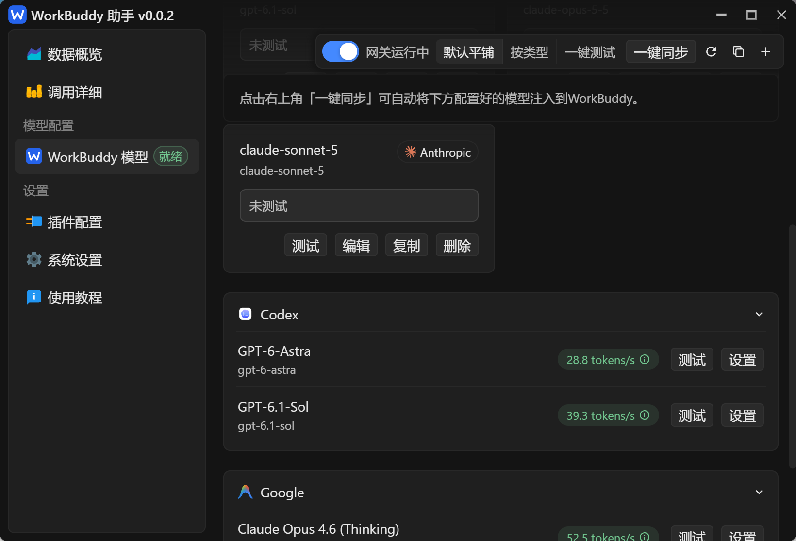
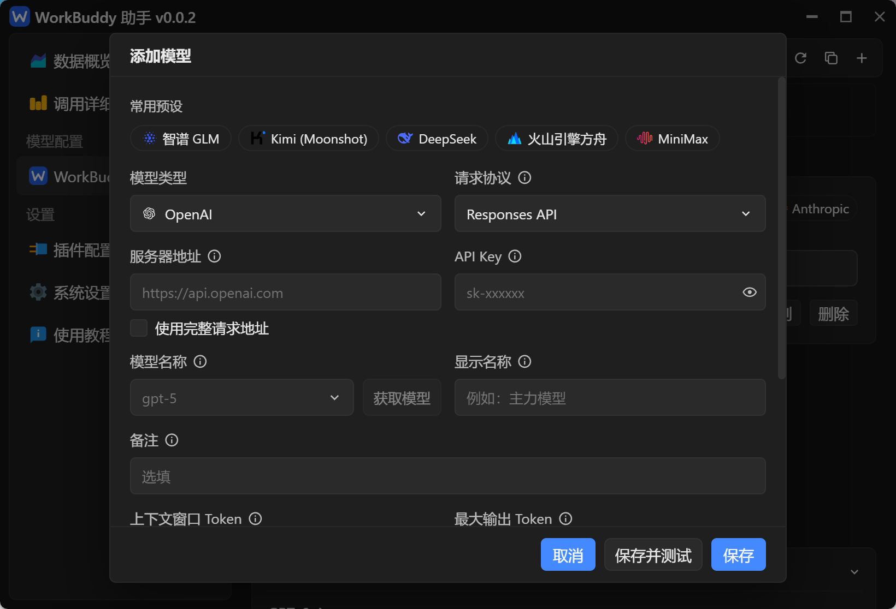
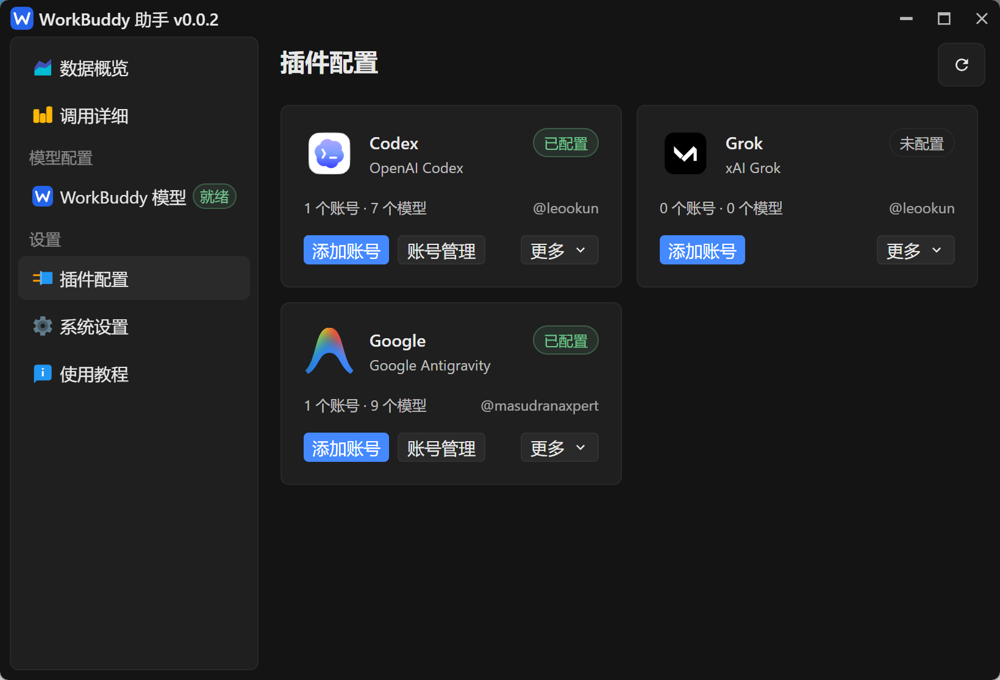
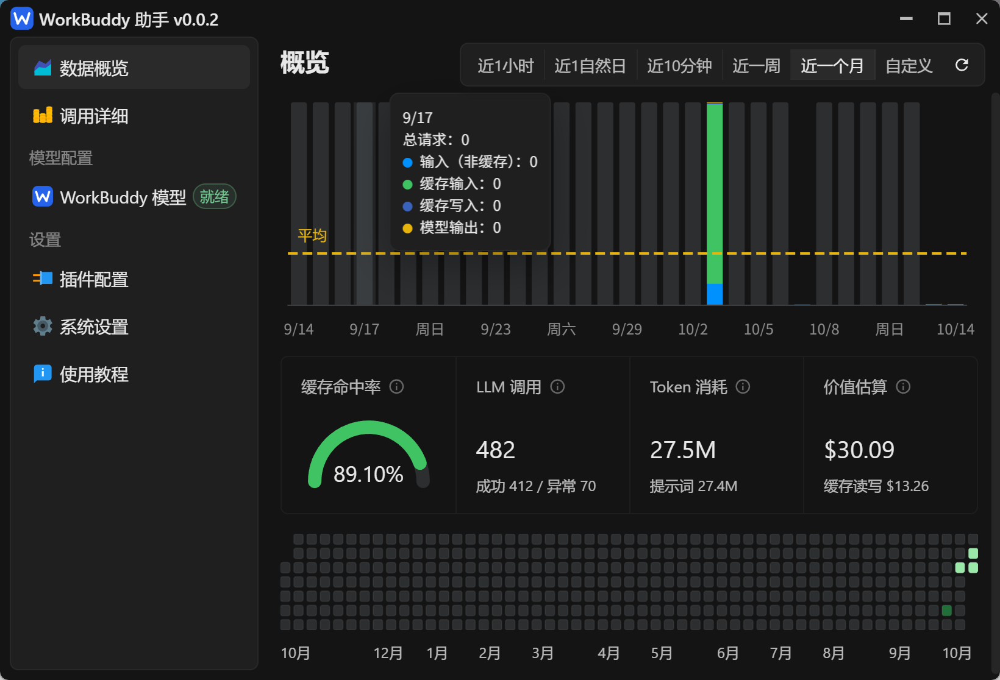
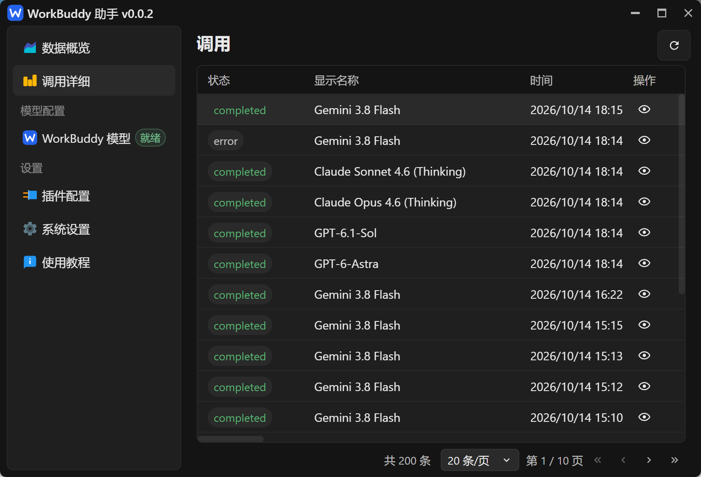
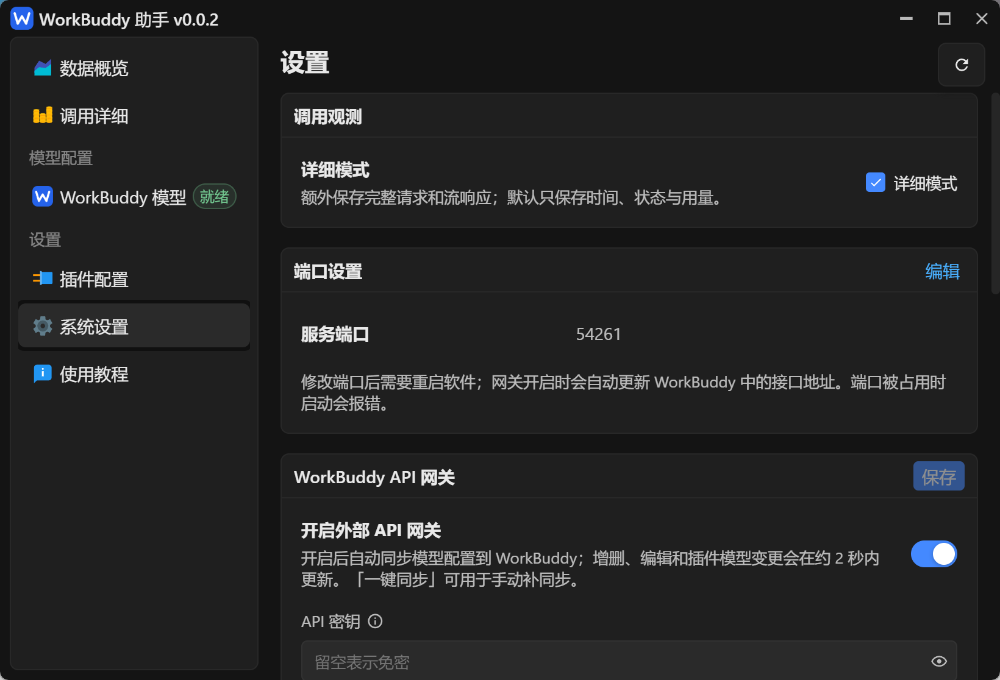

# WorkBuddy BYOK 使用教程

[返回项目首页](../README-CN.md) · [下载安装包](https://github.com/RyanLi888/workbuddy-byok/releases/latest)

本教程以 WorkBuddy 助手 v0.0.2 的中文界面截图为例，带你完成模型接入、测试、同步和调用排查。截图中的模型名称、账号数量、测试速度与统计数据仅作界面示例，实际以你的配置和服务商返回结果为准。

## 1. 安装并选择接入方式

先安装 WorkBuddy，再从上方下载入口安装适合自己系统的 WorkBuddy BYOK，启动后即可配置模型。桌面安装包无需另装 Rust、Node.js 或单独启动服务。

有两种接入方式，任选一种即可，也可以同时使用：

| 接入方式 | 需要准备 | 从哪里开始 |
| --- | --- | --- |
| 自定义 API | 服务商提供的请求协议、接口地址、API Key 和模型标识 | 「WorkBuddy 模型」→ 右上角「＋」 |
| 账号插件 | 对应服务的账号或插件支持的凭据文件 | 「插件配置」→ 初始化插件 →「添加账号」 |

首次安装时网关默认关闭。先完成模型配置与测试，再开启网关并同步到 WorkBuddy。

## 2. 添加自定义 API 模型

### 打开模型页

点击左侧「WorkBuddy 模型」。上方是网关开关、展示方式、测试与同步操作；下方列出自定义模型和已配置的插件模型。



点击右上角「＋」，打开「添加模型」窗口。

### 填写模型信息



1. **选择预设或手动配置。** 使用智谱 GLM、Kimi、DeepSeek、火山引擎方舟、MiniMax 时，可点击「常用预设」填入地址和部分模型参数，再填写自己的 API Key。预设对应的服务或套餐应与你的密钥匹配；切换到另一家预设会清空原来的密钥。
2. **选择模型类型和请求协议。** 「OpenAI」表示兼容 OpenAI 格式的接口，可选 Responses API 或 Chat Completions API；「Anthropic」使用 Messages 格式。应按服务商接口支持的协议选择，而不是按模型名字选择。
3. **填写服务器地址和 API Key。** 地址来自模型服务商，API Key 是访问该服务的密钥。地址拼接方式见下表。
4. **填写模型名称和显示名称。** 「模型名称」是发送给上游的模型标识，必须与服务商支持的名称一致；「显示名称」是你在界面和 WorkBuddy 中辨认模型的名字，例如「主力模型」。两者都需要填写。
5. **按需填写备注和参数。** 备注可作为 WorkBuddy 中的模型说明；上下文窗口、最大输出 Token 可留空使用默认值。窗口可以向下滚动，查看推理或思考强度、自定义 Headers 和额外参数；按所用接口的要求填写即可。
6. 点击底部 **「保存并测试」**。只想保存配置时，点击「保存」，之后再从模型卡片发起测试。

| 地址填写方式 | 如何填写 | 请求地址如何生成 |
| --- | --- | --- |
| 不勾选「使用完整请求地址」 | 填服务器基础地址，如 `https://api.example.com` | 按所选协议追加 `/v1/responses`、`/v1/chat/completions` 或 `/v1/messages`；基础地址末尾已有版本段时不重复追加 `/v1` |
| 勾选「使用完整请求地址」 | 填服务商给出的完整 URL，如 `https://api.example.com/custom/chat/completions` | 原样使用该 URL，不追加或修改路径；请求格式仍由所选协议决定 |

`api.example.com` 是格式示例，请替换成服务商实际地址。若服务商给的是完整端点 URL，应勾选「使用完整请求地址」，避免重复拼接请求路径。

填写地址和 API Key 后，可点击「获取模型」读取接口提供的模型列表，再从下拉框选择。若接口不支持模型列表或获取失败，也可以直接输入服务商给出的模型标识。

### 测试与日常管理

- **测试：** 单独测试该模型。成功后显示生成速度，悬停结果旁的说明图标或「查看详情」可查看首字时间、总耗时、输出 Token 和返回内容；失败时查看错误提示。
- **一键测试：** 测试当前自定义模型和已配置的插件模型，适合批量检查连接。测试期间可以取消测试。
- **编辑：** 修改地址、密钥、模型标识或参数，保存后建议再次测试。
- **复制：** 以现有自定义模型配置为基础添加另一个模型。
- **删除：** 确认后移除自定义模型，网关开启时会同步更新 WorkBuddy 中的托管配置。
- **默认平铺 / 按类型：** 切换自定义模型的展示方式；满足分组条件时还会出现「按供应商」。插件模型按插件分组，可以点击组标题折叠或展开。

测试会向上游实际发送请求，可能消耗额度。截图中的 `tokens/s` 是当次测试结果，实际使用速度会随模型、网络和请求内容变化。

## 3. 使用账号插件

点击左侧「插件配置」。截图展示了 Codex、Grok 和 Google 三个插件卡片，可查看配置状态、账号数和模型数。



1. **初始化运行时。** 首次进入会提示「需要先初始化插件运行时」。点击「初始化插件」，等待下载、校验和安装完成；失败时检查网络后重试。
2. **添加账号。** 在目标插件卡片点击「添加账号」，按弹窗中的登录方式操作。网页授权方式会打开浏览器；若显示设备验证码，按提示在授权网页输入并确认。完成后返回助手查看结果。
3. **检查模型目录。** 登录成功后会保存账号并同步模型目录。若提示「账号已保存，但同步模型失败」，进入「账号管理」，使用「同步模型」重试。
4. **管理账号和模型。** 已配置的插件会显示「账号管理」，其中可查看账号、执行插件提供的账号操作，并通过「模型管理」调整插件模型配置。
5. **测试插件模型。** 回到「WorkBuddy 模型」，展开对应插件分组，点击模型右侧「测试」。右侧「设置」会打开「插件配置」，用于继续管理账号。

「更多」中会按插件能力提供「批量导入」「批量导出」和版本信息。导入时请选择该插件支持的凭据文件；导出的文件可能包含登录凭据，应妥善保存。

插件显示「已配置」表示已有配置，不保证每次调用都成功。可用模型与调用结果取决于账号权限、额度和上游服务状态。

## 4. 开启网关并同步到 WorkBuddy

模型测试成功后，回到「WorkBuddy 模型」页面：

1. 打开顶部网关开关，状态变为 **「网关运行中」**。该开关立即保存并生效。
2. 等待约 2 秒自动同步，或点击 **「一键同步」** 立即写入模型配置。同步按钮需要网关已开启才能使用。
3. 在 WorkBuddy 中刷新模型设置或重启 WorkBuddy，找到同步后的模型，并在对话中选择它。
4. 发送一条简单请求验证实际调用，再到助手的「调用详细」查看对应记录。

调用过程如下：

```text
助手中添加 API 模型 / 配置插件账号
    → 测试模型
    → 开启网关
    → 自动同步 / 一键同步 → WorkBuddy 模型配置

WorkBuddy 选择模型并发送请求
    → 本地网关 → 自定义 API / 账号插件 → 模型返回结果
    → WorkBuddy 展示结果、执行工具并继续对话
    → 助手记录调用与用量
```

使用期间保持助手运行。关闭窗口可留在托盘；从托盘退出软件会停止本地服务，WorkBuddy 将无法通过该网关继续调用。

同步会写入当前用户的 `~/.workbuddy/models.json`，保留个人模型，并在写入前备份为 `models.json.bak`。上游 API Key 保留在助手中，写入 WorkBuddy 的是本地网关地址和网关密钥。更改显示名称后，已有对话需要重新选择模型。

通常无需手动填写 WorkBuddy 的接口地址。需要手动检查时，模型页右上角的复制图标会复制完整网关请求 URL。默认基础地址为 `http://127.0.0.1:3721/v1`，完整请求 URL 为 `http://127.0.0.1:3721/v1/chat/completions`；修改过端口时，以当前配置为准。

左侧「使用教程」目前打开的是 [WorkBuddy 官方模型配置说明](https://www.codebuddy.cn/docs/workbuddy/From-Beginner-to-Expert-Guide/Function-Description/Model)，可补充了解 WorkBuddy 端的模型设置。

## 5. 查看数据概览

点击左侧「数据概览」，查看调用量和 Token 使用情况。



- **时间范围：** 顶部可选「近1小时」「近1自然日」「近10分钟」「近一周」「近一个月」或「自定义」，用右侧刷新按钮重新加载。
- **Token 图表：** 悬停柱子可查看该时间段的总请求数、非缓存输入、缓存输入、缓存写入和模型输出；黄色虚线表示平均值。
- **缓存命中率：** 默认按「缓存读取 ÷（缓存读取 + 非缓存输入）」计算，指标旁的说明图标可查看口径。
- **LLM 调用：** 查看已记录的历史调用总量及成功、异常数量，进行中的调用不计入汇总。
- **Token 消耗：** 包含提示词和模型输出；缓存读写已计入提示词侧统计。
- **价值估算：** 按系统设置中的 Token 单价估算，单位为美元，适合了解用量规模；实际账单以服务商为准。
- **活动热力图：** 查看长期调用活动的分布。

截图中的 `482` 次调用、`27.5M` Token 和 `$30.09` 都是示例数据。

## 6. 查看调用详细并排查错误

点击左侧「调用详细」，按状态、显示名称和时间定位请求。



1. 点击右上角刷新按钮，加载最新调用记录。模型测试也会产生调用记录。
2. 查找目标模型与调用时间。`completed` 表示调用完成，`error` 表示调用发生错误。
3. 点击该行右侧的 **眼睛图标**，进入详情。
4. 在「调用信息」查看路由、最终请求地址、HTTP 状态、耗时、Token 用量及错误信息，区分模型测试和 WorkBuddy 的实际请求。
5. 若已开启详细模式，还可以查看「请求」中的请求头和请求体，以及「响应流」中的返回内容。

底部可调整每页条数，并跳转首页、上一页、下一页和末页。窗口较窄时，表格可横向滚动查看其他列。

默认只保存调用的基本信息与用量。若「请求」或「响应流」提示未记录内容，请先按下一节开启详细模式，再复现一次问题；开启后不会补回历史调用的正文。

## 7. 配置系统设置

点击左侧「系统设置」，按需调整调用观测、端口和网关设置。



### 详细模式

勾选「调用观测」中的「详细模式」会立即保存，之后的调用额外记录完整请求和流响应，适合排查问题。记录可能包含提示词、代码或其他敏感内容；分享日志前请检查并脱敏。

### 服务端口

点击「端口设置」右上角「编辑」，填写可用的固定端口并保存，然后重启助手。网关开启时会自动更新 WorkBuddy 中的接口地址；端口被占用会导致启动报错。

默认端口为 **3721**。截图中的 **54261** 是该示例环境的配置值，无需照抄。

### WorkBuddy API 网关

- **开启外部 API 网关：** 与模型页顶部开关控制同一个网关。在系统设置中修改开关后，需要点击该卡片右上角「保存」才生效。
- **API 密钥：** 这是 WorkBuddy 访问本地网关时使用的密钥，与添加模型时的上游 API Key 用途不同。留空允许免密调用；填写后请求需携带该密钥。修改后保存，并确保已同步到 WorkBuddy。
- **接口地址：** 卡片下方显示当前网关基础地址，可用于核对端口。

页面向下滚动还有 Token 价格等设置。调整价格后会影响首页的价值估算，单价单位为美元 / 百万 Token。

## 8. 常见问题

| 现象 | 处理方式 |
| --- | --- |
| 「保存」提示必填项为空 | 检查服务器地址或完整 URL、API Key、模型名称和显示名称 |
| 「获取模型」按钮不可用或获取失败 | 先填地址与 API Key；接口不支持列表时手动填写模型标识，再测试 |
| 测试报鉴权、模型不存在或路径错误 | 核对密钥所属服务与套餐、模型标识、请求协议，以及是否误把完整 URL 当成基础地址 |
| 插件账号已保存但没有模型 | 在「账号管理」点击「同步模型」，检查错误提示和账号权限 |
| 「一键同步」不可用 | 先开启网关，等待当前保存或同步操作结束 |
| WorkBuddy 中没有出现模型 | 检查网关状态与同步错误，点击「一键同步」，再刷新 WorkBuddy 模型设置或重启 WorkBuddy |
| 测试成功，但 WorkBuddy 请求失败 | 保持助手运行，检查当前端口与网关密钥，并在「调用详细」查看实际请求的错误 |
| 调用详情没有请求或响应内容 | 开启「详细模式」后重新发起请求，历史正文无法补录 |
| 修改端口后连接失败 | 重启助手，确认新端口未被占用，重新同步并刷新 WorkBuddy |

仍有问题时，可在 [Issues](https://github.com/RyanLi888/workbuddy-byok/issues) 中提供软件版本、操作系统、复现步骤和脱敏后的错误信息。
